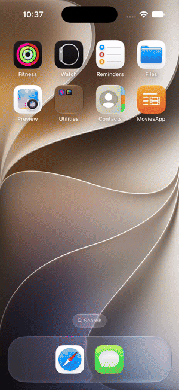

# MoviesApp

MoviesApp is a SwiftUI movie browser built to demonstrate practical MVVM patterns in an iOS app. Search for movies, browse poster results, and open a detail screen with credits, plot, ratings, and other metadata. Its layout adjusts for iPhone, iPad, and iPad multitasking window sizes.

## App previews
| iPhone | iPad |
| --- | --- |
|  |  |

## Architecture overview

The app separates presentation, state, data models, and networking:

- **Views and screens** (`MoviesApp/Views` and `MoviesApp/Screens`) render the interface with SwiftUI and send user actions to view models.
- **View models** (`MoviesApp/View Models`) own screen state and presentation data. They conform to `ObservableObject`, expose changes with `@Published`, and are isolated to `@MainActor` so UI-facing state is updated on the main actor.
- **Async work** starts from the screens with `Task { ... }` and calls async view-model methods. The view models set a shared loading state (`none`, `loading`, `success`, or `failure`) as requests progress.
- **Services** (`MoviesApp/Services`) keep networking out of the views. `HTTPClient` builds on `URLSession`'s async API, decodes JSON into model types, and reports request or decoding failures. `URLComponents` and query items construct OMDb URLs safely.
- **Models** (`MoviesApp/Models`) represent the decoded movie search and detail responses. Small view-model wrappers expose the list data needed by the SwiftUI cards.

This is a learning project: it shows one straightforward way to connect SwiftUI, Combine's `ObservableObject`/`@Published`, and Swift concurrency (`async`/`await`, `Task`, and `@MainActor`).

## Requirements

- Xcode with an iOS 18 or later simulator/runtime (the app target uses iOS 18).
- An OMDb API key for live movie search and detail requests.

## Project setup

1. Clone or download this repository and open `MoviesApp.xcodeproj` in Xcode.
2. Create a free OMDb API key at [omdbapi.com/apikey.aspx](https://www.omdbapi.com/apikey.aspx). Follow OMDb's registration instructions and activate the key if required.
3. Open `MoviesApp/Utils/Constants.swift` and replace the `API_KEY` value with your key:

   ```swift
   static let API_KEY = "YOUR_OMDB_API_KEY"
   ```

4. Keep `ENVIRONMENT` set to `.live` to use OMDb. Set it to `.local` to use the bundled demo responses without making API requests.
5. Select the `MoviesApp` scheme and an iOS 18+ iPhone or iPad simulator in Xcode, then build and run.

The API key is compiled into the app when stored in source code, so it should not be treated as a secret. Avoid committing your personal key to a public repository. For a public demo, use a key intended for sharing or move key configuration to an ignored local configuration file; a production app should keep credentials behind a backend service. If a key has already been committed, remove it from the source and rotate it with OMDb.

## License

This project is distributed under the MIT License. See [LICENSE](./LICENSE) for the full text.
